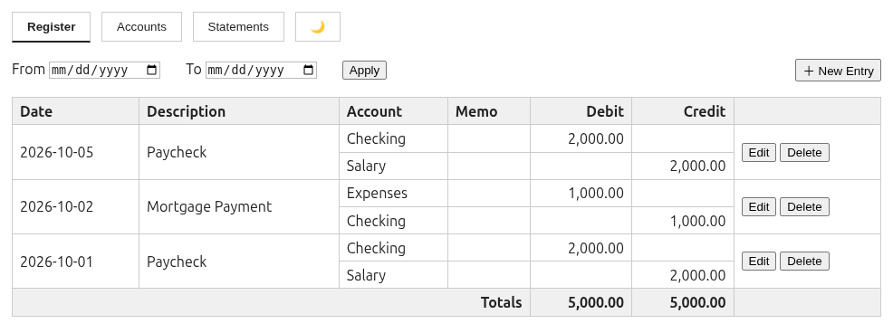
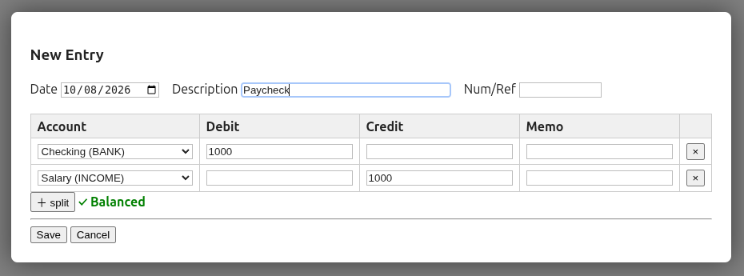
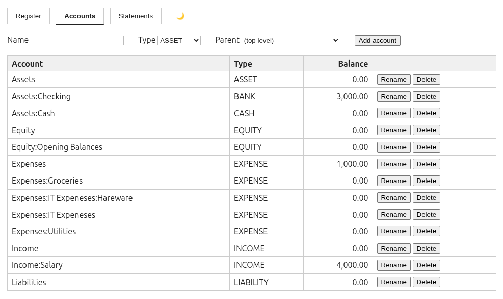
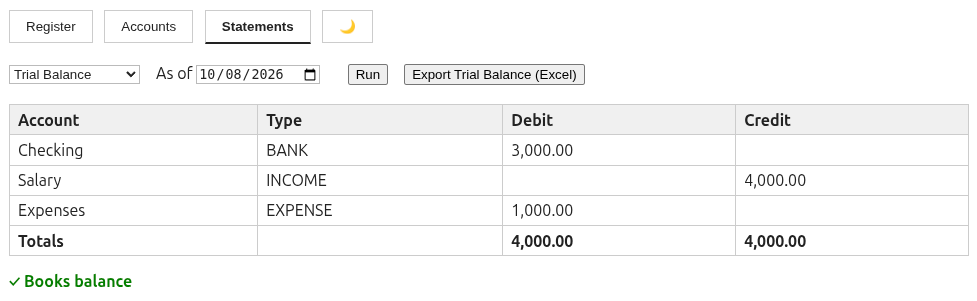

# Ledger

A minimal, self-hosted, double-entry accounting web application for personal
bookkeeping. Tracks transactions through journal entries and produces core 
financial statements — all running entirely on your local machine, with your 
data in a single SQLite database file.

Built as a lightweight alternative to heavyweight desktop accounting suites:
no cloud, no accounts, no network exposure, no telemetry. Just you and your books.

## Screenshots

### Register — journal entries with edit/delete



### New Entry — double-entry capture with live balance check



### Accounts — hierarchical chart of accounts with balances



### Statements — trial balance with integrity check



## Features

- **Double-entry journal**:  Enforced balancing so the server rejects any entry 
  whose debits and credits don't sum to zero
- **Four financial statements**:
  - Trial Balance (with automated integrity check)
  - Income Statement (period P&L)
  - Balance Sheet (with imputed current earnings, so it ties without closing entries)
  - Cash Flow (direct method, grouped by counter-account)
- **Account management**:  A hierarchical chart of accounts with create, rename,
  delete, blank-name protection, and duplicate-name prevention (case-insensitive,
  per-parent)
- **Journal entry editing**:  Allows full atomic edit and delete of transactions
- **Excel export**:  Export the trial balance as a genuine `.xlsx` file (stdlib-
  generated, no third-party Excel libraries)
- **Dark mode**:  System preference detection and persistence
- **Localhost-only by design**:  Binds to `127.0.0.1` and never exposed to the network
- **Exact-money arithmetic**:  All amounts are stored as integer minor units (cents) and 
  floats never touch your books

## Requirements

- Python 3.10+
- Linux / macOS / Windows (any platform supporting Python)

Dependencies: FastAPI, Uvicorn, Pydantic. 
The Excel writer uses only the standard library, and the frontend is dependency free
vanilla JS.

## Setup

```bash
# 1. Clone and enter the project
cd ledger

# 2. Create and activate a virtual environment
python3 -m venv ledger_env
source ledger_env/bin/activate        # On Windows: ledger_env\Scripts\activate

# 3. Install dependencies
pip install -r requirements.txt

# 4. Run
python -m ledger.main
```

Then open **http://127.0.0.1:8000** in your browser.

On first run the app creates `ledger.db` in the repository root and seeds
a starter chart of accounts (Assets:Checking, Assets:Cash, Income:Salary,
Expenses:Groceries, and more), which you can rename, extend, or prune as 
necessary.

## Usage

1. **Register tab**:  Click *＋ New Entry*, pick a date, description, and at
   least two splits (debit/credit). The modal shows a live balance indicator;
   saving is blocked client side and validated server side until debits
   equal credits.
2. **Accounts tab**:  View balances, add accounts, rename, or delete
   (accounts with transactions or children can't be deleted).
3. **Statements tab**:  Choose a statement, set the period or as of date,
   and click Run. The trial balance and balance sheet display a ✓/✗
   integrity check; if either ever shows ✗, stop and investigate your data.
4. **Export**:  With a trial balance displayed, click 
   *Export Trial Balance (Excel)* to download a `.xlsx` with numeric
   amount columns you can sum and format in Excel or LibreOffice.

Toggle dark mode with the 🌙 button in the navigation bar; the choice is
remembered across sessions and defaults to your system preference.

## Project structure

The application is split into focused modules so changes stay localized:
edit the module that owns the concern, without wading through the rest.

```
ledger/
├── ledger/                    # Python package (backend)
│   ├── __init__.py
│   ├── main.py                # App assembly, routers, static mounting
│   ├── database.py            # Connection handling, schema, seed accounts
│   ├── models.py              # Pydantic request models
│   ├── services.py            # Business logic: accounts, journal, statements
│   ├── utils.py               # Money formatting, cents conversion, XLSX writer
│   └── routes/
│       ├── __init__.py
│       ├── accounts.py        # /accounts endpoints
│       ├── journal.py         # /journal endpoints
│       └── statements.py      # /statements endpoints + Excel export
├── static/                    # Frontend (vanilla JS, no build step)
│   ├── index.html             # Markup
│   ├── css/
│   │   └── styles.css         # Themed styles (CSS variables, dark mode)
│   └── js/
│       ├── core.js            # Shared helpers, API wrapper, state
│       ├── theme.js           # Dark mode toggle
│       ├── accounts.js        # Accounts tab logic
│       ├── journal.js         # Register tab + entry modal
│       ├── statements.js      # Statements tab + export
│       └── app.js             # Tab navigation, boot
├── requirements.txt
├── .gitignore
├── LICENSE
└── README.md
```

## API overview

REST API mounted under `/api/v1`, designed to be usable independently of
the frontend:

| Area | Endpoints |
|------|-----------|
| Accounts | `GET/POST /accounts`, `PATCH/DELETE /accounts/{guid}` |
| Journal | `GET/POST /journal`, `GET/PUT/DELETE /journal/{guid}` |
| Statements | `GET /statements/trial-balance`, `/income-statement`, `/balance-sheet`, `/cash-flow` |
| Export | `GET /statements/trial-balance/excel` |

Example:  Posting a balanced journal entry:

```bash
curl -X POST http://127.0.0.1:8000/api/v1/journal \
  -H 'Content-Type: application/json' \
  -d '{"date":"2026-10-07","description":"Supermarket run","splits":[
        {"account":"<expense-guid>","debit":"42.10"},
        {"account":"<checking-guid>","credit":"42.10"}]}'
```

Amounts in API responses are formatted decimal strings (e.g. `"2,000.00"`);
internally everything is stored as exact integer cents.

## Design notes

- **Single-user, local-first**:  Concurrency, authentication, and multi-user
  semantics are deliberately out of scope. The server binds to localhost only.
- **Layered backend**:  Routes handle HTTP concerns only; business rules
  (balancing, duplicate checks, statement math) live in `services.py`,
  unit-testable without a web server; persistence is confined to `database.py`.
- **Atomic transaction edits**:  Editing a journal entry replaces the whole
  transaction and all its splits in one operation.  Splits are never edited
  in isolation, thereby preserving double-entry invariants.
- **Derived statements**:  Income and expense accounts are never formally
  closed; the balance sheet presents current earnings as an imputed equity
  line, so the sheet always ties: `Assets = Liabilities + Equity + Earnings`.
- **No build step**:  The frontend is plain HTML/CSS/JS loaded in a fixed
  order so there is no bundler, node_modules, and nothing to compile.
- **Schema compatibility**:  The SQLite schema mirrors the GnuCash table
  layout (`accounts`, `transactions`, `splits`) to keep a future migration
  path toward GnuCash interoperability open.

## Roadmap ideas

- [ ] Excel export for income statement and balance sheet
- [ ] Reconciliation workflow (statement matching against bank records)
- [ ] Print stylesheet for statement PDFs
- [ ] Hierarchical balance rollups in the Accounts tab
- [ ] CSV import
- [ ] Website for interacting with database while mobile and GnuCash on desktop

## License

This project is licensed under the MIT License — see the [LICENSE](LICENSE) file for details.
